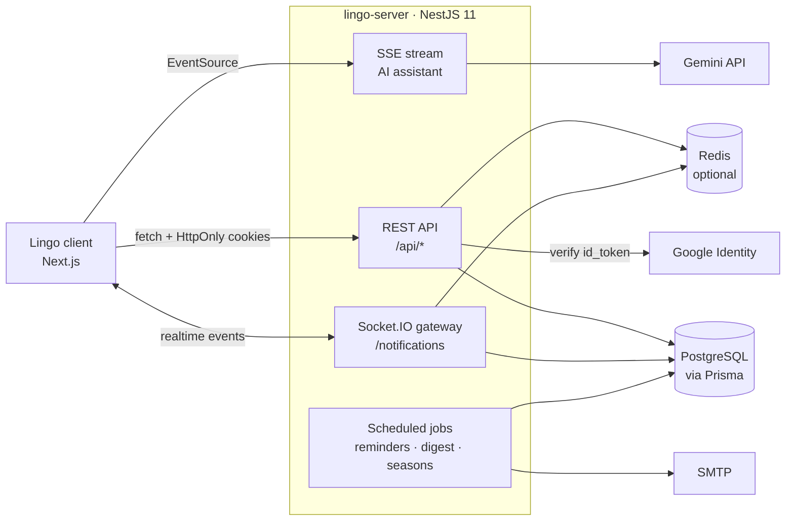

# Lingo Server — English Learning API for Vietnamese Learners

Backend for **Lingo**, a web app that teaches English to Vietnamese speakers across **6 levels**
(Beginner → Advanced, roughly CEFR A1 → C2). Learners study vocabulary with spaced-repetition
flashcards, follow topic-based lessons, practise listening, dictation and pronunciation, play
mini-games and real-time duels, and ask an AI study assistant when they get stuck.

This repository contains the **NestJS API**. The Next.js frontend lives in a separate
repository.

## Features

**Learning**
- 8,600+ words across 6 levels, grouped into 650+ topic-based lessons, each with IPA,
  Vietnamese meaning and an example sentence.
- Spaced-repetition flashcards with two schedulers (SM-2 and FSRS) plus an end-of-session quiz.
- 72 grammar points (12 per level) with explanations and bilingual examples, plus level exams.
- Practice modes: listening, dictation and pronunciation, with per-user practice statistics.
- Vocabulary notebook: save words, review "difficult" words, and quiz yourself on them.
- Learn from YouTube videos: English captions are fetched automatically and machine-translated
  into Vietnamese.
- Placement survey that recommends a starting level and a study plan.

**AI study assistant**
- RAG over grammar points and FAQ using the Gemini API, with per-user context (streak, lessons
  in progress, recent practice).
- Answers stream token by token over Server-Sent Events, with multiple chat sessions.
- Tool calling to suggest pages or videos, and a configurable daily question limit per user.

**Engagement**
- Streaks (timezone-aware), daily goals, achievements, wallet and leaderboards.
- Mini-games and real-time 1v1 duels with ELO ranking, rank tiers and monthly seasons.
- Follow other learners, 1-1 real-time messaging, referrals and in-app notifications over
  WebSockets.
- Web Push study reminders and a weekly email digest.

**Accounts and admin**
- Email/password sign-up with email verification, Google sign-in, password reset.
- JWT access + rotating refresh tokens stored in HttpOnly cookies, with reuse detection.
- Role-protected admin endpoints to edit words, grammar points and videos, and to review words
  reported by learners or flagged by the AI checker.

## Architecture



- One NestJS module per domain (see [Modules](#modules)).
- Input is validated with `class-validator`; environment variables are validated with `zod` at
  startup, so the app refuses to start with a missing or invalid required variable.
- A global JWT guard protects every route unless it is marked `@Public()`; admin routes also
  require the `admin` role.
- Without Redis, WebSockets run in single-instance mode and log a warning instead of crashing.

## Tech stack

| Area | Technologies |
| --- | --- |
| Runtime | Node.js 22, TypeScript |
| Framework | NestJS 11, Socket.IO, Swagger, `@nestjs/schedule`, `@nestjs/throttler` |
| Database | PostgreSQL, Prisma 7 (`@prisma/adapter-pg` driver adapter), Redis (optional, ioredis) |
| Validation | class-validator, zod 4 |
| AI & integrations | Gemini API (`@google/genai`), google-auth-library, web-push, Nodemailer, youtube-transcript |
| Spaced repetition | SM-2 (built-in), FSRS (`ts-fsrs`) |
| Testing & tooling | Jest, ts-jest, Supertest, ESLint, Prettier |

## Getting started

### Prerequisites

- Node.js 22
- PostgreSQL (developed on 16), or Docker for the bundled `docker-compose.yml`
- Optional: Redis, a [Gemini API key](https://aistudio.google.com/apikey) for word data and the
  AI assistant, a Google OAuth client ID for Google sign-in

### Run locally

```bash
cp .env.example .env          # set DATABASE_URL and the two JWT secrets
docker compose up -d          # optional: Postgres on port 2222, Redis on port 2223
npm install
npx prisma generate           # builds the Prisma client into src/generated
npx prisma migrate deploy
npm run db:seed
npm run start:dev             # http://localhost:8000/api
```

- API docs (Swagger): `http://localhost:8000/api/docs` (development only)
- Health check: `GET /api/health`

Docker is optional: `DATABASE_URL` can point at any PostgreSQL you already run.

### Admin access

```bash
npm run user:set-role -- you@example.com admin
```

## Environment variables

All variables are documented in [`.env.example`](.env.example). The most important ones:

| Variable | Required | Purpose |
| --- | --- | --- |
| `DATABASE_URL` | yes | PostgreSQL connection string |
| `JWT_ACCESS_SECRET`, `JWT_REFRESH_SECRET` | yes | Token signing secrets (≥ 16 characters, generate with `openssl rand -base64 48`) |
| `FRONTEND_URL` | yes | Client origin, used for CORS and redirects |
| `REDIS_URL` | no | Socket.IO adapter, OAuth state and caching |
| `GOOGLE_CLIENT_ID` | no | Google sign-in (`id_token` verification) |
| `GEMINI_API_KEY` | no | AI assistant and the vocabulary enrichment scripts |
| `MAIL_HOST`, `MAIL_USER`, `MAIL_PASSWORD` | no | SMTP; when empty, emails are printed to the console |
| `VAPID_PUBLIC_KEY`, `VAPID_PRIVATE_KEY` | no | Web Push; generate with `npx web-push generate-vapid-keys` |
| `ASSISTANT_DAILY_LIMIT` | no | Assistant questions per user per day (default 30) |

Never commit `.env`; it is git-ignored.

## Vocabulary data

Words ship with the seed (`data/processed/words.seed.json`). To rebuild them from the source word
lists (needs `GEMINI_API_KEY`):

```bash
npm run data:fetch-sources
npm run data:enrich-words     # resumable; results are cached in data/processed/enrich-cache.json
npm run data:build-words
SEED_RESET=true npm run db:seed
```

Without `GEMINI_API_KEY`, words have no Vietnamese meaning, IPA or examples, and the AI assistant
reports that it is disabled; the rest of the API keeps working. `data:enrich-words` only processes
words that are still missing, so it can be re-run after the free Gemini quota resets. Details:
[`scripts/import/README.md`](scripts/import/README.md).

> **Seeding and admin edits.** `npm run db:seed` only creates missing grammar points, so edits
> made through the admin endpoints are kept; `SEED_GRAMMAR_OVERWRITE=true` rewrites them from the
> seed file. `SEED_RESET=true` deletes every word, which also removes saved notebook words, review
> progress, learner reports, review status and any vocabulary edits made by admins.

## Scripts

| Command | What it does |
| --- | --- |
| `npm run start:dev` | Start the API in watch mode |
| `npm run build` | Generate the Prisma client and compile to `dist/` |
| `npm run start:prod` | Run the compiled build |
| `npm test` | Jest unit tests (`*.spec.ts` in `src/`, `scripts/`, `prisma/`) |
| `npm run test:e2e` | Smoke tests (needs PostgreSQL + Redis) |
| `npm run lint` | ESLint + Prettier (auto-fix) |
| `npx prisma migrate deploy` | Apply database migrations |
| `npm run db:seed` | Seed levels, achievements, words, lessons, grammar |
| `npm run data:check-words` | Ask Gemini to proofread words and flag doubtful ones for review |
| `npm run user:set-role` | Grant or revoke a user role |

## Modules

| Module | Responsibility |
| --- | --- |
| `auth` | Sign-up, login, email verification, password reset, Google sign-in, token rotation |
| `users` | Profiles, settings, avatars (stored in PostgreSQL), follows |
| `onboarding` | Placement survey and study plan |
| `vocabulary` | Levels, words, search, learner word reports |
| `learn` | Topic-based lessons |
| `srs` | Spaced-repetition queue and review (SM-2 / FSRS) |
| `notebook` | Saved and difficult words |
| `grammar` | Grammar points |
| `exams` | Level exams |
| `practice` | Listening, dictation and pronunciation attempts and stats |
| `videos` | YouTube lessons, transcripts, translation, comments and likes |
| `assistant` | Gemini-powered RAG assistant with SSE streaming and daily quota |
| `gamification` | Streaks, daily goals, achievements, quizzes |
| `progress` | Learning progress and statistics |
| `leaderboard` | Rankings (XP, streak, ELO) |
| `minigame` | Single-player mini-games |
| `duel` | Real-time 1v1 duels, ELO, rank tiers and seasons |
| `wallet` | In-app currency |
| `messages` | 1-1 direct messages |
| `notifications` | In-app notifications over Socket.IO |
| `push` | Web Push subscriptions and study reminders |
| `mail` | Transactional email and weekly digest |
| `referrals` | Referral codes and rewards |
| `admin` | Content management and word review queue |

## Project structure

```
src/
  modules/          one NestJS module per domain
  common/           decorators, guards, filters, level constants (levels.ts)
  config/           environment validation (zod)
  infra/            Prisma and Redis providers
  health/           health check endpoint
prisma/
  schema.prisma     database schema
  migrations/       SQL migrations (baseline 0_init + later changes)
  seed/             seed data and seed scripts
scripts/
  import/           vocabulary ETL pipeline (CEFR lists + Gemini)
data/               source notices and the processed word seed
docs/               deployment notes
test/               end-to-end smoke tests
```

## Technical decisions

- **Levels:** 6 levels mapped from CEFR (A1 → 1 … C2 → 6). Level constants live only in
  `src/common/levels.ts` (and its client counterpart); the number of levels is never hardcoded.
- **Spaced repetition:** SM-2 by default; FSRS can be selected per user. Progress rows store the
  fields of both, so switching needs no migration.
- **Auth:** HttpOnly cookies (`lingo_access`, `lingo_refresh`); refresh tokens are stored hashed,
  rotate on use, and token reuse is detected per token family.
- **Stateless server disk:** uploaded avatars and the assistant's embedding index are stored in
  PostgreSQL, not on the filesystem, so the API runs on hosts with an ephemeral disk without
  losing images or re-embedding on every restart.
- **Prisma 7:** the client is generated into `src/generated/prisma` (git-ignored) and imported
  from there. CLI configuration lives in `prisma.config.ts`.
- **Audio:** there are no recorded audio files; the client pronounces words with the browser's
  English text-to-speech voice, so `audioUrl` is null.
- **AI-generated content:** IPA, Vietnamese meanings and example sentences were generated by
  Gemini and have not all been reviewed by hand. Learners can report a wrong word,
  `npm run data:check-words` flags doubtful words, and admins work through unreviewed, reported
  and AI-flagged words. The AI never approves a word by itself.

## Deployment

The GitHub Actions workflow in `.github/workflows/deploy.yml` lints and builds every push and pull
request to `main`. Automatic deployment to a VPS over SSH with PM2 is opt-in: set the repository
variable `DEPLOY_ENABLED=true` and the `VPS_*` secrets. First-time server setup and the full list
of secrets are in [`docs/deploy.md`](docs/deploy.md).

## Data sources

Word lists come from CEFR-J 1.5 (A1–B2) and Octanove C1/C2, licensed CC BY-SA 4.0. See
[`data/NOTICES.md`](data/NOTICES.md) for attribution.
